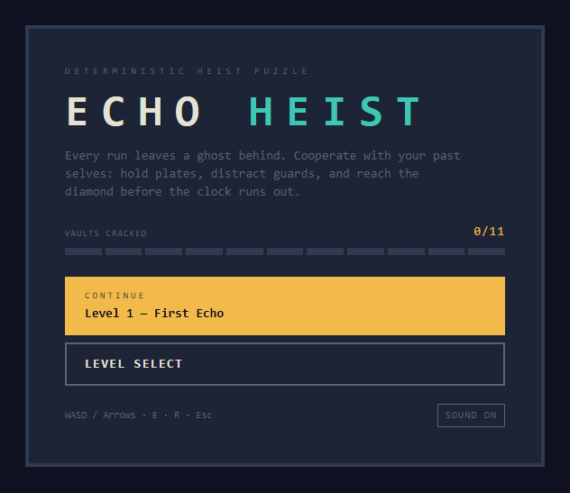
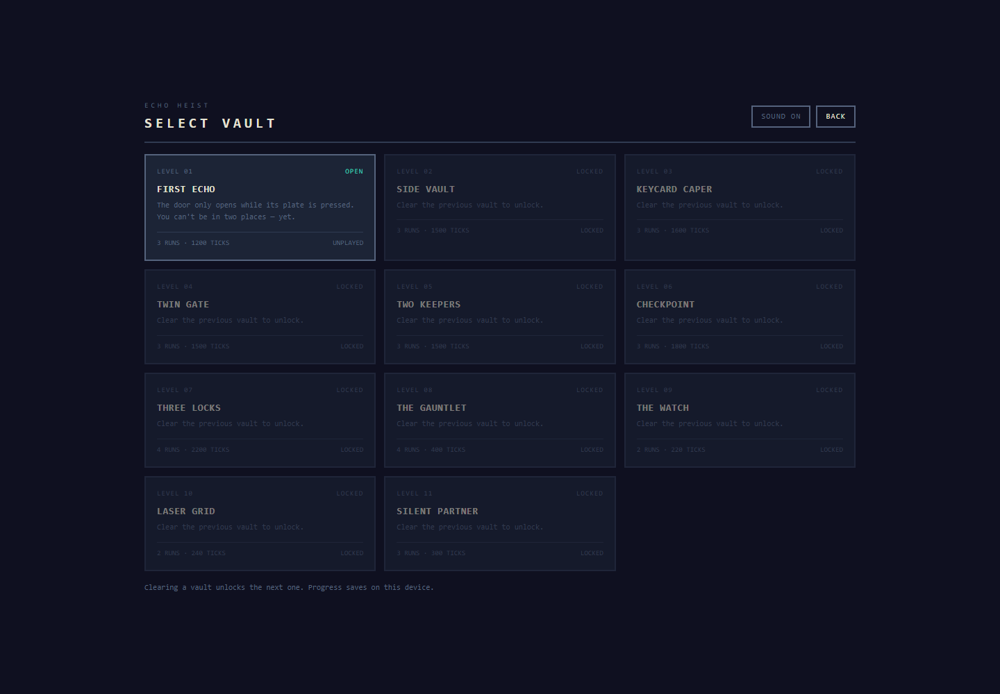
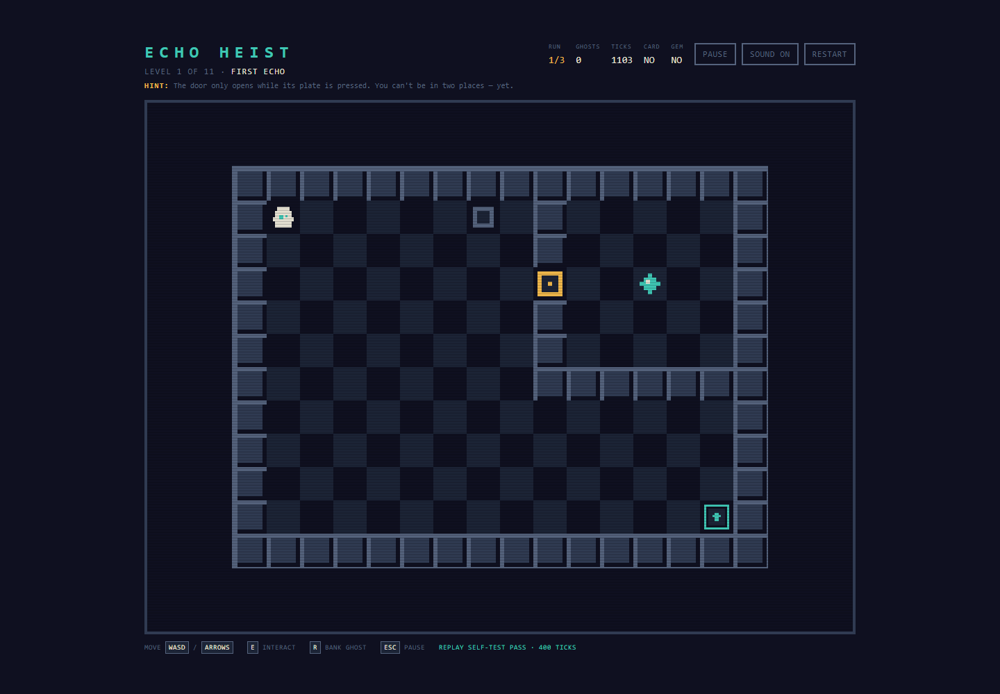
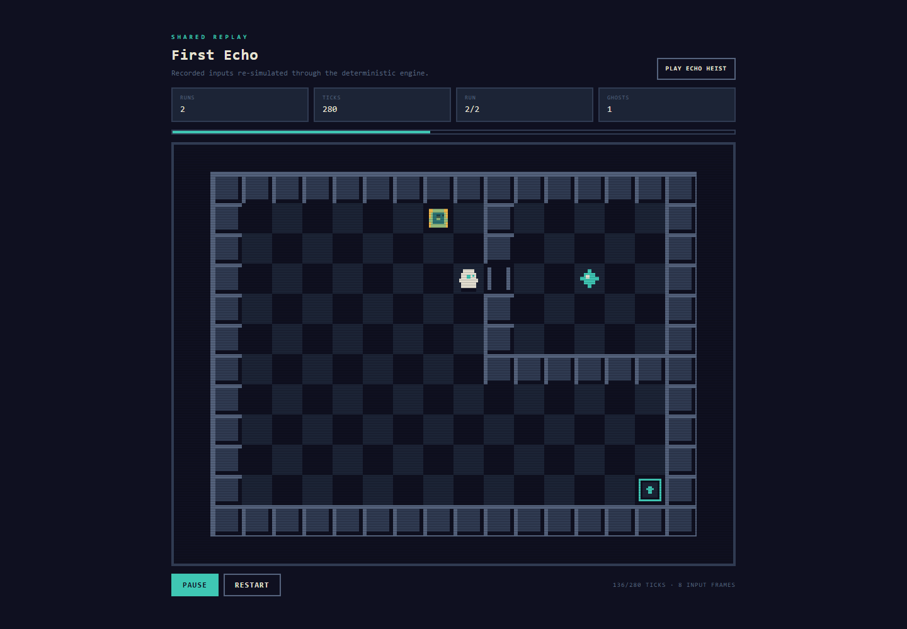
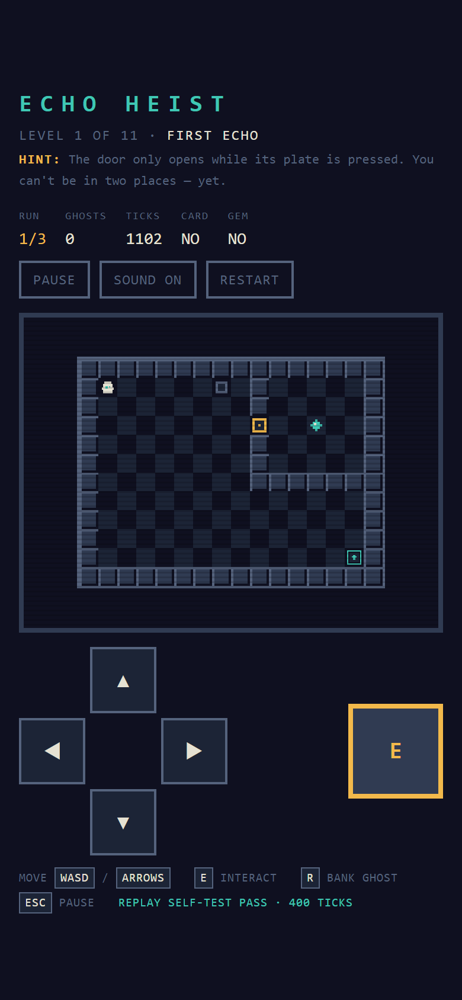
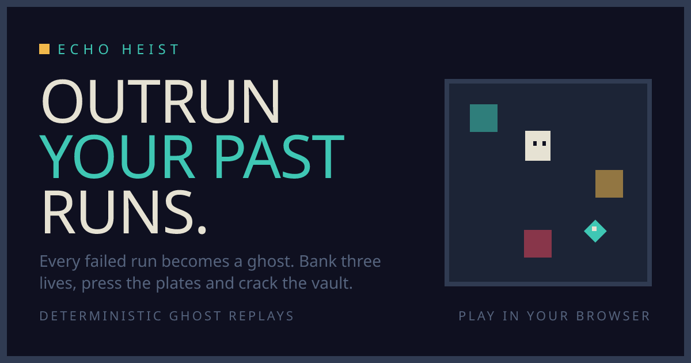

# Echo Heist

A top-down stealth-puzzle game for the browser. Every failed run is recorded and becomes a
translucent ghost. On the next run, your past self repeats those exact inputs through the same
deterministic simulation — holding plates, opening doors, carrying keycards and distracting
guards so you can reach the diamond and escape.

Built with Next.js App Router, React, TypeScript, HTML5 Canvas and Tailwind CSS. Levels are JSON;
the leaderboard and share links use serverless route handlers with optional Upstash Redis storage.

## Screenshots

| Main menu | Level select |
| --- | --- |
|  |  |

| Gameplay | Shared solution replay |
| --- | --- |
|  |  |

| Mobile gameplay |
| --- |
|  |

The social preview card is generated by Next.js from `app/opengraph-image.tsx`:



## Features

- Deterministic 60 Hz game loop; simulation state advances only in integer ticks.
- Change-only per-tick input recording: a standstill costs one input frame, not thousands.
- Ghost replays are fed through the exact same `step()` function as the live player.
- Pressure plates, linked doors, keycards, locked doors, diamonds and exits.
- Patrol guards with deterministic, wall-blocked sight lines.
- Timed and plate-powered lasers.
- 11 JSON levels, each with a stored solution that is verified in CI-style scripts.
- Keyboard and touch controls, pause menu, local progress and mute persistence.
- 8-color pixel-art renderer with integer scaling and a capped device-pixel ratio.
- Share links that encode a compressed winning solution into `/replay/[id]`.
- Server-side replay re-simulation before a leaderboard score is accepted.
- Rate limiting, request-size caps and strict input validation on the API.
- Open Graph / Twitter metadata, generated social card, favicon, robots and sitemap.

## Quick start

Requires Node.js 20.9 or newer (Vercel Node 22.x is recommended).

```bash
npm install
npm run dev
```

Open <http://localhost:3000>.

No environment variables are required for local play. In development, if no Redis credentials
are present, the leaderboard uses an in-process memory store. Production deliberately returns
`503` for leaderboard APIs when storage is not configured, rather than silently losing scores.

For production:

```bash
npm run build
npm start
```

## Controls

| Input | Action |
| --- | --- |
| `WASD` / arrow keys | Move. If several directions are held, the newest press wins. |
| `E` | Action input. It is recorded and replayed; the current level pack uses contact-triggered plates, keycards and the diamond, so no level requires `E`. |
| `R` | End the current run immediately and bank it as a ghost. |
| `Esc` or `P` | Pause / resume during an active run. |
| Touch D-pad | Move on mobile. |
| Touch `E` | Queue the action input on mobile. |
| Pause / Restart / Sound buttons | Pause, reset the level and ghosts, or toggle audio. |

A run also ends automatically when the per-run tick limit expires, a guard sees the player, or a
laser is active on the player's tile. The run is banked as a ghost unless that was the final
allowed run. Reaching the exit while carrying the diamond wins the level.

## Scripts

| Command | What it does |
| --- | --- |
| `npm run dev` | Start the Next.js development server. |
| `npm run build` | Production build. |
| `npm start` | Serve the production build. |
| `npm run typecheck` | TypeScript with `--noEmit`. |
| `npm run test:debug` | Record scripted runs, replay each one twice and assert identical final states. |
| `npm run test:hazards` | Negative tests for guard/laser levels and their stored solutions. |
| `npm run verify-levels` | Replay every level's stored solution through `GameSession`; exits nonzero on failure. |
| `npm run check:share` | Round-trip every solution through the share codec, re-verify it, and prove truncated replays are rejected. |
| `npm run check:share -- 3` | Print a share ID for level 3 (useful for API testing). Add `tamper` to produce a replay that must fail server verification. |

Expected level verifier output ends with:

```text
11/11 levels verified
```

## How the echo loop works

1. The browser loop calls `GameSession.tick(playerInput)` at a fixed 60 ticks per second.
2. `RunRecorder` stores only frames where `{ dx, dy, action }` changed, keyed by simulation tick.
3. `step(state, inputs, level)` moves the player and every ghost from the recorded inputs.
4. When a run ends, `RunRecorder.finish(endTick)` banks the recording and a new run starts with all
   previously banked ghosts active.
5. On a win, `GameSession.getSolution()` returns the banked ghosts plus the final winning run.
6. The same recordings are compressed into a share ID and can be re-simulated by the server.

Doors are resolved from positions at the start of a tick, so entity iteration order cannot change
the outcome. A door tile occupied by any entity always counts as open, which prevents door-crush
states. Guard positions, laser phases and plate states are all pure functions of tick, positions
and level data.

Determinism rules enforced by the code:

- No `Math.random()`, `Date.now()`, `performance.now()` or DOM access inside `game/sim`.
- Movement and hazards use integer tick counts, never milliseconds.
- The exact `InputFrame` passed to `step()` for the player is the frame recorded for that tick.
- Ghosts and server-side verification use the same `step()` and `FrameCursor` implementation.
- The presentation loop may drop or clamp wall-clock time, but never invents a partial simulation
  tick.

## Project structure

```text
app/                    Next.js routes, API handlers, metadata and social images
components/             React UI: menu, HUD, board, replay player, share panel
game/sim/               Pure deterministic simulation and input recordings
game/engine/            Fixed-timestep loop and per-level GameSession
game/renderer/          Canvas renderer and palette
game/replay/            Share codec and server-side replay verifier
game/levels/            JSON validation, registry and solution driver
levels/                 Level JSON files
lib/server/             Redis REST store, rate limiting and HTTP helpers
scripts/                Determinism, hazard, level and share-link checks
docs/screenshots/       README images
```

## Adding a level

Levels are data: add a JSON file under `levels/`, import it in `game/levels/registry.ts`, and run
the verifier. No simulation, renderer or UI changes are needed.

### Grid tiles

Every grid row must have the same width. Levels are usually `16 x 12`.

| Tile | Meaning |
| --- | --- |
| `#` | Wall. Blocks movement and guard sight. |
| `.` | Floor. |
| `P` | Player spawn. Exactly one per level. |
| `p` | Pressure plate. Active while any entity stands on it. |
| `d` | Linked door. Open while its linked plate is occupied. |
| `K` | Keycard. Picked up by the entity that steps on it. |
| `L` | Locked door. Passable only by an entity carrying a keycard. |
| `D` | Diamond / objective. Picked up on contact. |
| `E` | Exit. Wins only if the player carries the diamond. |

A level must contain exactly one `P`, at least one `D` and at least one `E`.

### Level schema

```json
{
  "id": 12,
  "name": "New Vault",
  "hint": "Short in-game hint shown in the HUD.",
  "maxRuns": 3,
  "tickLimit": 1200,
  "grid": [
    "################",
    "#P.....p.#.....#",
    "#........#.....#",
    "#........d..D..#",
    "#........#.....#",
    "#........#.....#",
    "#........#######",
    "#..............#",
    "#..............#",
    "#..............#",
    "#.............E#",
    "################"
  ],
  "links": [
    { "plate": [7, 1], "door": [9, 3] }
  ],
  "guards": [],
  "lasers": [],
  "solution": [
    {
      "description": "Stand on the plate and bank this run.",
      "path": [[7, 1]],
      "holdTicks": 40,
      "end": "run"
    },
    {
      "description": "Walk under the held door, take the diamond and reach the exit.",
      "path": [[8, 1], [8, 3], [9, 3], [12, 3], [9, 3], [8, 3], [8, 10], [14, 10]],
      "end": "win"
    }
  ]
}
```

Top-level fields:

- `id`: positive integer, unique across the pack. Levels are sorted by id.
- `maxRuns`: runs allowed for the level, including the winning run (1–10).
- `tickLimit`: ticks available per run (at least 60).
- `links`: pairs of plate `[x, y]` and door `[x, y]` coordinates. Both must reference the matching
  tile types. A plate can be linked to more than one door if needed.
- `guards`: patrol definitions. `path` is a closed loop of axis-aligned `[x, y]` waypoints on floor
  tiles; `speed` is ticks spent on each tile. Guards do not block movement.
- `lasers`: each laser has a non-empty `tiles` list and exactly one power source:
  - `cycle: { "onTicks": 40, "offTicks": 40, "phase": 0 }` for a timer, or
  - `plate: [x, y]` for a plate that turns the beam **off** while occupied.
- `solution`: required proof that the level is solvable. Every level is replayed by
  `npm run verify-levels`.

### Solution paths

Waypoints are `[x, y]` or `[x, y, waitTicks]`. The verifier drives one input per tick toward the
current waypoint. On reaching a waypoint with a third value, it waits that many ticks before moving
on. This is how timed lasers and guard patrols are crossed.

`holdTicks` applies after the whole path is finished, before a non-winning run is banked. The final
solution run must have `"end": "win"` and must actually reach the exit with the diamond. Every
earlier run must use `"end": "run"`.

### Register and verify

Add the import and registry entry:

```ts
import level12 from '../../levels/level-12.json';

const levels = loadLevels([
  // ...
  { file: 'levels/level-12.json', data: level12 },
]);
```

Then run:

```bash
npm run verify-levels
npm run test:debug
npm run test:hazards
npm run check:share
npm run typecheck
```

If a level is unsolvable or references the wrong tile, the loader/verifier reports the specific
file, run, tick and coordinates. The production build also fails fast on invalid level JSON because
the registry validates the pack at module load.

## Online features

### `POST /api/score`

```json
{
  "levelId": 1,
  "runsUsed": 2,
  "totalTicks": 280,
  "playerName": "ECHO",
  "solution": "z...share-id..."
}
```

`solution` is the share ID of the winning run. The server decodes it, re-simulates every run with
the same engine, verifies the claimed run count and total ticks, and only then writes the score.
Identical names improve their own best score on a level; they do not create duplicates.

### `GET /api/leaderboard?levelId=1`

Returns the top 20 verified scores for a level:

```json
{
  "levelId": 1,
  "levelName": "First Echo",
  "scores": [
    { "rank": 1, "playerName": "ECHO", "runsUsed": 2, "totalTicks": 280 }
  ]
}
```

### Share links

Winning solutions are packed as JSON, deflate-raw compressed, base64url encoded, and opened at:

```text
/replay/<share-id>
```

The replay page decodes and re-verifies the recordings on the server before rendering. It then
plays the solution back through the normal renderer, with pause, restart and progress controls.
Share pages are marked `noindex`; use them as unlisted links, not as private secrets.

### Storage

The API uses Upstash Redis's REST protocol. It is compatible with the environment variables
injected by the Upstash Redis integration on Vercel (historically surfaced as Vercel KV):

| Variable | Purpose |
| --- | --- |
| `KV_REST_API_URL` or `UPSTASH_REDIS_REST_URL` | HTTPS REST endpoint. |
| `KV_REST_API_TOKEN` or `UPSTASH_REDIS_REST_TOKEN` | REST token with read/write access. |
| `RATE_LIMIT_SALT` | Private salt for hashing client IPs in rate-limit keys. |
| `NEXT_PUBLIC_SITE_URL` | Canonical production origin for metadata and social images. |

No schema or migration is required. Scores are stored in sorted sets
(`eh:v1:lb:<levelId>`, best 100 kept) and rate-limit counters (`eh:v1:rl:*`) expire automatically.

Rate limits are 10 score submissions and 60 leaderboard reads per IP per minute. Request bodies are
capped at 64 KB, share IDs at 12,000 characters, and decompressed replay data at 256 KB.

### Anti-cheat scope

Re-simulation proves that a submitted replay **wins** under the deterministic rules. It cannot prove
that the submitter authored the inputs: share links are public, so a copied winning solution can be
submitted. Unique names per level and rate limits reduce abuse but are not identity or authorship
verification. Do not present the leaderboard as a trusted competitive ranking without accounts.

## Deployment on Vercel

### 1. Put the code on GitHub

The repository is expected at:

```text
https://github.com/shamiunnabi360-lab/echoheist.git
```

If the project is not yet a Git repository, initialize it from this folder and push:

```bash
git init
git add .
git commit -m "Echo Heist: deployment and final polish"
git branch -M main
git remote add origin https://github.com/shamiunnabi360-lab/echoheist.git
git push -u origin main
```

If the remote already contains commits, pull or merge before pushing rather than force-pushing.

### 2. Import the repository

1. Sign in to Vercel and choose **Add New → Project**.
2. Import `shamiunnabi360-lab/echoheist`.
3. Framework preset: **Next.js**.
4. Root Directory: `./`.
5. Build Command: `npm run build` (the default).
6. Output Directory: `.next` (the default).
7. Node.js version: **22.x** is recommended.
8. Deploy. The game itself works even before Redis is configured; the leaderboard APIs return
   `503` until storage credentials exist.

### 3. Create the Redis database

1. In the Vercel project, open **Storage** (or the **Marketplace**) and create an **Upstash Redis**
   database. This is the integration previously presented as Vercel KV.
2. Connect it to the Echo Heist project for **Production**, **Preview** and **Development**.
3. Confirm the project now has either:
   - `KV_REST_API_URL` + `KV_REST_API_TOKEN`, or
   - `UPSTASH_REDIS_REST_URL` + `UPSTASH_REDIS_REST_TOKEN`.
4. Do not use a `redis://` URL here; the code expects the HTTPS REST endpoint and token.

### 4. Add environment variables

In **Project → Settings → Environment Variables**:

| Variable | Value |
| --- | --- |
| `NEXT_PUBLIC_SITE_URL` | `https://<your-production-domain>` (no trailing slash required) |
| `RATE_LIMIT_SALT` | A long random private string |
| Redis URL/token | Injected by the Redis integration, or pasted from its REST credentials |

`NEXT_PUBLIC_SITE_URL` is read at build time for canonical URLs and social images. Set it to the
custom domain if you add one, then redeploy. Without it, Vercel's system URL for the current
deployment is used.

### 5. Redeploy and verify

Environment changes require a new deployment. After redeploying:

```bash
curl -i https://<your-domain>/api/leaderboard?levelId=1
curl -I https://<your-domain>/opengraph-image
curl -I https://<your-domain>/twitter-image
curl https://<your-domain>/robots.txt
```

Expected results:

- Leaderboard returns `200` with `scores` (possibly empty), not `503`.
- Both social image routes return `200 image/png`.
- `robots.txt` and `sitemap.xml` use the production origin.
- The home page HTML contains the production `og:image` URL.

For local production testing with real Redis, copy `.env.example` to `.env.local`, fill in the REST
credentials, then run `npm run build && npm start`.

## Pre-release verification

Local checks:

```bash
npm run typecheck
npm run test:debug
npm run test:hazards
npm run verify-levels
npm run check:share
npm run build
```

Manual smoke test:

1. Main menu → level select → open level 1.
2. Move onto the plate, press `R`, then use the ghost-held door to take the diamond and exit.
3. Confirm the win overlay, share link, copy button, score submission and leaderboard.
4. Open the share link in a fresh tab and confirm the replay plays, pauses and restarts.
5. On a narrow viewport, confirm the touch D-pad, action button and pause/restart controls.
6. Pause during gameplay, switch tabs for several seconds, return and resume. The game must not
   jump forward in a burst.
7. Open a truncated share link and confirm a friendly "Replay unavailable" message.

Live URL checklist:

- [ ] `/` loads on mobile and desktop without layout overflow.
- [ ] `Continue`, level select, locked states and best-run labels behave correctly.
- [ ] Keyboard movement, `E` recording, `R` banking, `Esc`/`P` pause and restart work.
- [ ] Touch D-pad and action button work; the board stays crisp and responsive.
- [ ] Sound starts after a gesture, mute survives reload and audio never affects the simulation.
- [ ] A full level can be won; win overlay, replay button and progress save are correct.
- [ ] Share link opens `/replay/[id]`, re-verifies and plays through to the vault.
- [ ] Score submission returns a rank; duplicate names improve instead of duplicating.
- [ ] Leaderboard returns top 20 entries and rate limits send `429` plus `Retry-After`.
- [ ] Tampered, truncated and wrong-level share links are rejected.
- [ ] `/api/leaderboard` is not `503` and data survives a redeploy.
- [ ] OG/Twitter preview uses the production domain and renders the 1200×630 card.
- [ ] `robots.txt`, `sitemap.xml`, favicon and `theme-color` are present.
- [ ] Pause the game, background the tab, return and resume without a tick burst or stuck keys.
- [ ] Production console shows no errors; replay self-test passes in the game footer.

## Implementation notes

- The renderer skips redraws when the immutable state snapshot and canvas size are unchanged, so a
  paused or finished board does not repaint every animation frame. The device-pixel ratio is capped
  at 2 for high-DPI mobile fill-rate.
- The fixed loop resets its accumulator on `visibilitychange`, preventing a backgrounded tab from
  simulating a catch-up burst when it returns.
- Keyboard listeners, the pause listener, the audio-unlock listeners, the HUD interval, the game
  loop and the replay loop all have explicit cleanup.
- The HUD interval only updates during an active, unpaused, visible run; the share panel aborts
  its leaderboard fetch and clears its copy-status timer on unmount.
- `localStorage` reads and writes are guarded; corrupt or blocked storage falls back to empty
  progress rather than crashing the menu.
- The fixed loop and all DOM/audio code live outside `game/sim`; muting, rendering, frame rate and
  wall-clock timing cannot change the simulation.

## License

No license file is included in this repository. Add one before distributing the project publicly.
